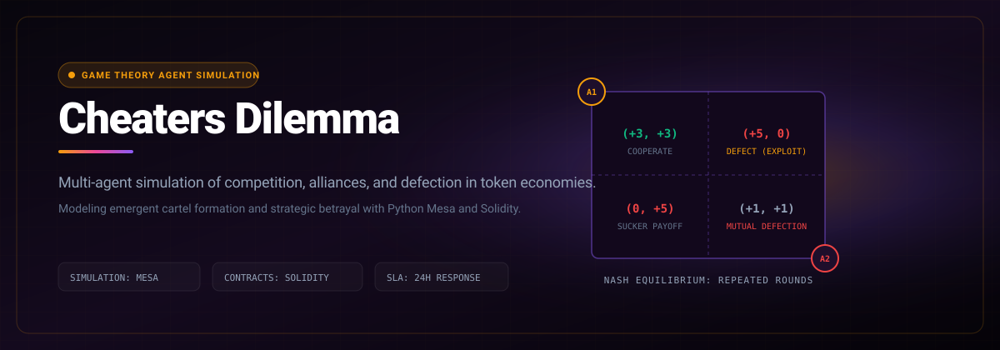

# Cheaters Dilemma

> Multi-agent game theory simulation modeling competition and defection in decentralized token economies.

```bash
git clone https://github.com/Luxion-Labs/Cheaters-Dilemma.git && cd Cheaters-Dilemma && pip install -r requirements.txt
```



[](https://cheaters-dilemma.vercel.app) [](LICENSE) [](CONTRIBUTING.md)

## Overview
Multi-agent game theory simulation modeling competition and defection in decentralized token economies. Built by Luxion Labs as part of our high-velocity open-source engineering ecosystem.

## Features
- Multi-agent simulation of classical and repeated prisoner dilemma variations.
- Dynamic governance voting mechanisms under asymmetric information.
- Tokenized staking and punishment models analyzing cartel stability.
- Exportable telemetry and payoff matrices in CSV and JSON formats.

## Architecture and Stack
Python, Mesa simulation framework, NumPy, Matplotlib, and Next.js frontend.

## Quickstart
```bash
git clone https://github.com/Luxion-Labs/Cheaters-Dilemma.git && cd Cheaters-Dilemma && pip install -r requirements.txt
```

## Maintainer Response SLA
Luxion Labs enforces a strict 24-hour response SLA on all community issues, feature proposals, and pull requests. See [CONTRIBUTING.md](CONTRIBUTING.md) for full development guidelines.

## License
Distributed under the MIT License. See [LICENSE](LICENSE) for more details.
